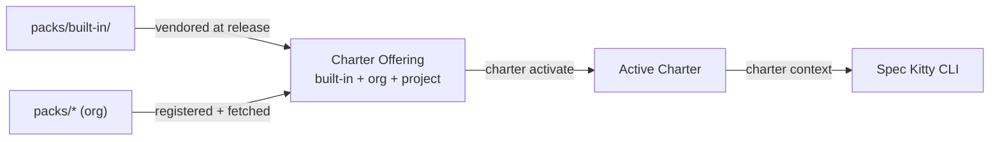

<div align="center">
    
    <h1>Spec Kitty Open Packs</h1>
    <p><strong>Open, free Charter Packs for Spec Kitty — the governed, distributable behavioural configuration of the Brain Kitty line.</strong></p>
</div>

[](LICENSE)
[](#status)
[](https://spec-kitty.github.io/spec-kitty-open-packs/)

> [!WARNING]
> **Work in progress.** Pack boundaries, the manifest schema and the composition mechanics are
> still moving. Nothing here is versioned for production use yet.

## What this is

A **Charter Pack** is a distributable bundle of charter artefacts — directives, tactics,
styleguides, toolguides, paradigms, procedures, agent profiles, skills, glossary packs and
presets — that shapes how AI agents work on a governed [Spec Kitty](https://github.com/spec-kitty/spec-kitty)
project. This repository is where those packs are **authored, validated and published**.

Spec Kitty has three product lines:

| Line | What it is |
| --- | --- |
| **Build Kitty** | The free CLI that runs Missions, and its Mission Status Read API. |
| **Brain Kitty** | Governance: the charter ([`spec-kitty-charter`](https://github.com/spec-kitty/spec-kitty-charter)) and the Charter Packs it serves — **this repository**. |
| **Team Kitty** | "Multiplayer Mode": UI and multiplayer surfaces that consume the open-core APIs. |

## How packs reach the CLI



- **`packs/built-in/`** is the source of the built-in pack. Core fetches it at a pinned,
  checksummed commit and ships it in every wheel, so every install carries it. Each `vX.Y.Z`
  release publishes every pack as a reproducible archive with a `.sha256`, so a consumer can
  pin a release instead of a commit.
- **Every other `packs/*`** is an opt-in org-tier pack. A project registers them in `.kittify/config.yaml`
  and fetches them with `spec-kitty charter fetch`.
- Together with the project's own layer they form the project's **Charter Offering**; what the
  project activates from it is its **Active Charter**. At each Mission step the CLI asks the
  charter for the guidance that applies.

The **logic** — resolution, the Doctrine Relationship Graph (DRG), activation, the manifest
schema and the validator — belongs to the charter, today inside the core CLI and moving to
`spec-kitty-charter`. This repository holds **content and packaging**.

## The packs

| Pack | Tier | What it is |
| --- | --- | --- |
| [`built-in`](packs/built-in/) | built-in | Spec Kitty's built-in charter corpus; ships with the CLI. |
| [`qa`](packs/qa/) | org (opt-in) | QA and promise traceability. |
| [`event-driven`](packs/event-driven/) | org (opt-in) | Event-sourced design: versioned events, projections, idempotent consumers. |
| [`cave-kitty`](packs/cave-kitty/) | org (opt-in) | A terse, outcome-first communication voice. |
| [`internal`](packs/internal/) | org (maintainers) | Spec Kitty's own maintainer pack; never shipped in the CLI. |

Generated per-pack reference: [Packs](https://spec-kitty.github.io/spec-kitty-open-packs/packs/).

## Quick start

```yaml
# .kittify/config.yaml
charter_packs:
  org:
    packs:
      - name: qa
        local_path: "${SPEC_KITTY_PACK_HOME}/qa"
        source_type: git
        url: "https://github.com/spec-kitty/spec-kitty-open-packs.git"
        ref: "<commit SHA or tag>"   # never a branch
        subdir: packs/qa
```

```bash
spec-kitty charter fetch --pack qa
spec-kitty charter pack list
spec-kitty charter activate directive QA_001
```

Full walkthrough: [Getting started](https://spec-kitty.github.io/spec-kitty-open-packs/guides/getting-started/).

## For organisations

Packs are layered **built-in → org → project**. An org pack's `org-charter.yaml` can make
artefacts mandatory for every project that registers it (`required_<kind>`) and namespaces the
skills it ships; the built-in pack ships `default` and `minimal` presets as standard
provisionings. See [Organisations](https://spec-kitty.github.io/spec-kitty-open-packs/organisations/).

## Documentation

The docsite is built with [doc-kitty](https://github.com/spec-kitty/doc-kitty) from [`docs/`](docs/):

- [Overview](https://spec-kitty.github.io/spec-kitty-open-packs/) and [architecture](https://spec-kitty.github.io/spec-kitty-open-packs/architecture/overview/)
- [Charter artefacts](https://spec-kitty.github.io/spec-kitty-open-packs/artefacts/) — the structure of each kind
- [Contracts](https://spec-kitty.github.io/spec-kitty-open-packs/contracts/) — pack files, registration, commands, charter seams
- [Guides](https://spec-kitty.github.io/spec-kitty-open-packs/guides/) — use, compose, author, validate, publish
- [Glossary](https://spec-kitty.github.io/spec-kitty-open-packs/glossary/)

## Status

| Aspect | State |
| --- | --- |
| Packs | `built-in`, `qa`, `event-driven`, `cave-kitty`, `internal` exist; the wider [catalog](docs/packs/catalog-proposal.md) is proposed. |
| Validation | `spec-kitty charter pack validate` runs in CI for every pack. |
| Compound packs (`depends_on`) | Planned ([spec-kitty#2467](https://github.com/spec-kitty/spec-kitty/issues/2467)). |
| Trust / verified distribution | Planned ([spec-kitty#2539](https://github.com/spec-kitty/spec-kitty/issues/2539)). |

Issues here track **pack content**; issues in [core](https://github.com/spec-kitty/spec-kitty/issues)
track **charter behaviour**.

## Contributing

Pack proposals, corrections and authoring feedback are welcome — see
[CONTRIBUTING](CONTRIBUTING.md) and the [Code of Conduct](CODE_OF_CONDUCT.md). Packs can ship
executable assets, so read the [security position](SECURITY.md) before proposing one.

## License

[MIT](LICENSE). Charter content is free to use, adapt and redistribute.
