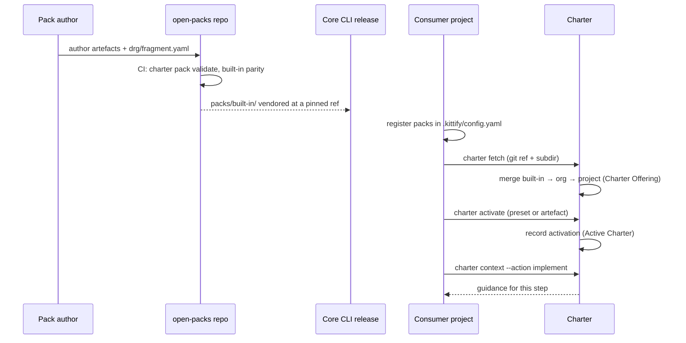

# Architectural overview

This page follows a charter artefact from the file it is authored in to the guidance an agent
receives during a Mission.

## Components

| Component | Owner | Role |
| --- | --- | --- |
| Pack source (`packs/built-in/`, `packs/<name>/`) | this repository | Authored charter artefacts, DRG fragments, presets, `pack.yaml`. |
| Pack validator | the charter (core CLI) | `spec-kitty charter pack validate` — schema and DRG checks, run here in CI. |
| Built-in pack pin | core CLI (`packs/built-in.source.yaml`) | Pins a commit and tree digest of this repository's `packs/built-in/`; core fetches it from there and ships it in every wheel. |
| Org pack cache | consumer machine | Packs fetched by `spec-kitty charter fetch` into `local_path`. |
| Project layer | consumer project (`.kittify/charter-packs/`) | Project-local artefacts, pack id `project`. |
| Charter Offering | the charter | The merged set a project can draw from. |
| Active Charter | the charter (`ActiveCharterService`) | What the project activated. |
| Charter context | the charter | Action-scoped guidance rendered for each Mission step. |
| Spec Kitty CLI | Build Kitty | Runs Missions; consumes charter context through the entry seams. |

## Flow

## The three layers

The Charter Offering is built from three additive layers, later layers refining earlier ones:

1. **Built-in** — `pack_level: built-in`. One pack, shipped with the CLI.
2. **Org** — `pack_level: org`. Any number of packs registered under `charter_packs.org.packs`;
   each may carry an `org-charter.yaml` that **requires** artefacts.
3. **Project** — `pack_level: project`. The project's own `.kittify/charter-packs/`.

Each layer contributes artefacts and a Doctrine Relationship Graph (DRG) fragment. The charter
merges the three graphs; edges such as `requires`, `suggests` and `specializes_from` connect
artefacts across layers. See [Organisations](../organisations/index.md) for how the org layer
is used.

## Offering versus activation

The offering is everything **available**; the Active Charter is what is **in force**. A kind
with no activation key is unrestricted (every offered artefact of that kind is effective) —
except skills, where only org-required skills are in force until the project activates more.
Org `required_<kind>` lists are in force for projects that register the pack; for most kinds
they also join the project's selection, while required skills, glossary packs and assets are
required without being merged into it (see [Organisations](../organisations/index.md)).

## The charter entry seams

The CLI does not reach into charter internals. It calls two seams:

- `charter.offering.api` — read the offering: packs, artefacts, the merged graph.
- `charter.activation.api` — read and change what is active.

Today these are Python packages inside the core CLI. The charter is being extracted into
[`spec-kitty-charter`](https://github.com/spec-kitty/spec-kitty-charter): first as an external
contract package, then as a service built against an OpenAPI 3.1 contract, with reads moving
behind the same seam before writes. Pack content and formats do not change with that move.
The charter service is not an event producer: Mission events come from the CLI and follow the
[`spec-kitty-events`](https://github.com/spec-kitty/spec-kitty-events) contracts.

## Where built-in content comes from

`packs/built-in/` is authored here. Core keeps no copy (spec-kitty/spec-kitty#6451): it pins a
commit and tree digest of this repository and fetches the pack from it for tests and wheel builds.
Content changes land here first; a core pin bump then picks them up (see
[`packs/built-in.source.yaml`](https://github.com/spec-kitty/spec-kitty-open-packs/blob/main/packs/built-in.source.yaml)).
The maintainer-only `internal` pack is also authored here, but it is an org pack and never
ships in the CLI wheel.
