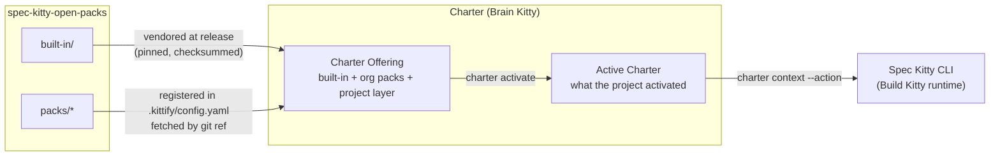

# Spec Kitty Open Packs

**Open, free Charter Packs for [Spec Kitty](https://github.com/spec-kitty/spec-kitty).** A
Charter Pack is a distributable bundle of charter artefacts — directives, tactics,
styleguides, procedures, agent profiles, skills and more — that shapes how AI agents work on
a governed project. This repository is where those packs are authored, validated and
published.

> **🚧 Work in progress.** Pack boundaries, the manifest schema and the composition mechanics
> are still moving. Nothing here is versioned for production use yet.

## Where this repository sits

Spec Kitty is organised in three product lines:

| Line | What it is | Repositories |
| --- | --- | --- |
| **Build Kitty** | The free CLI that runs Missions, plus its Mission Status Read API. | [`spec-kitty`](https://github.com/spec-kitty/spec-kitty) |
| **Brain Kitty** | Governance: the charter and the Charter Packs it serves. | **this repository**, [`spec-kitty-charter`](https://github.com/spec-kitty/spec-kitty-charter) |
| **Team Kitty** | "Multiplayer Mode": UI and multiplayer surfaces that consume the open-core APIs. | — |

Open packs are the **content** half of Brain Kitty: governed, distributable behavioural
configuration. The **logic** — resolving packs, merging their graphs, activating artefacts —
belongs to the charter.

## How packs reach the CLI

1. **Built-in** content (`built-in/`) is vendored into the CLI at a pinned, checksummed ref,
   so every consumer install carries it.
2. **Opt-in** packs (`packs/*`) are registered by a project or organisation under
   `charter_packs.org.packs` and fetched with `spec-kitty charter fetch`.
3. Together with the project's own layer, they form the project's **Charter Offering**:
   everything it *can* draw from.
4. The project activates a subset — by preset or artefact by artefact — and that becomes its
   **Active Charter**.
5. At each Mission step the CLI asks the charter for the guidance that applies
   (`spec-kitty charter context --action <action>`); the charter answers through its entry
   seams (`charter.offering.api` today, an OpenAPI-contracted service later).

Read the [architecture overview](architecture/overview.md) for the full picture.

## Start here

| I want to… | Go to |
| --- | --- |
| See which packs exist | [Packs](packs/index.md) |
| Adopt my first pack | [Getting started](guides/getting-started.md) |
| Govern many projects as an organisation | [Organisations](organisations/index.md) |
| Write my own pack | [Author a Charter Pack](guides/author-a-charter-pack.md) and [Charter artefacts](artefacts/index.md) |
| Check a file format or command | [Contracts](contracts/index.md) |
| Look up a term | [Glossary](glossary/index.md) |

## Division of responsibility

| Concern | Lives in |
| --- | --- |
| Charter artefacts, packs, presets, authoring and usage guides | this repository |
| Pack resolution, DRG merge, activation, manifest schema, validator | the charter — today `src/charter/` in [`spec-kitty`](https://github.com/spec-kitty/spec-kitty), moving to [`spec-kitty-charter`](https://github.com/spec-kitty/spec-kitty-charter) |
| Running Missions | the Spec Kitty CLI |

Issues here track **pack content**; issues in core track **charter behaviour**.
