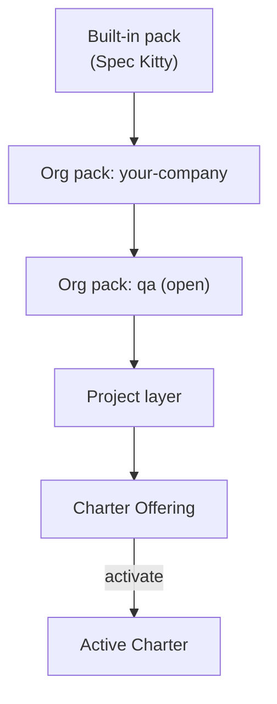

# Organisations

An organisation usually wants two things at once: **a common baseline** every project follows,
and **room for each project** to add what it needs. Charter Packs provide both through tiers.

## The three tiers

| Tier | `pack_level` | Who owns it | How a project gets it |
| --- | --- | --- | --- |
| Built-in | `built-in` | Spec Kitty | Ships with the CLI. |
| Org | `org` | Your organisation (or a community pack here) | Registered under `charter_packs.org.packs`. |
| Project | `project` | The project team | `.kittify/charter-packs/` in the repository. |

The charter merges the tiers in that order into the project's **Charter Offering**. Layers are
additive: a later layer adds artefacts and edges, and can refine an earlier one through DRG
relations (`enhances`, `overrides`, `specializes_from`). A project can register **several** org
packs — for example your company pack plus the open `qa` pack — each its own layer.



## What an org pack can enforce

An org pack's `org-charter.yaml` turns artefacts **on for every project that registers it**,
with no per-project activation step:

```yaml
org_name: your-company
skill_namespace: acme              # renders skills as acme-<id>
required_directives: [SEC_001]
required_procedures: [release-checklist]
required_toolguides: [internal-ci]
required_glossary_packs: [acme-glossary]
required_skills: [land-pr]
```

- `required_<kind>` lists are always in force for projects that register the pack.
- For most kinds the org's required list also joins the project's selection; skills, glossary
  packs and assets are required without being merged into it.
- Skills are the one kind that is **not** unrestricted by default: until a project activates
  skills, only the org-required skills (plus built-in defaults) are in force.
- `skill_namespace` is mandatory for an org that ships skills. See
  [Contracts](../contracts/index.md#org-charteryaml--org-policy) for the naming rules.

An org pack can also stay **inert**: ship artefacts and presets but require nothing, so each
project opts in. The open packs here (`qa`, `event-driven`, `cave-kitty`) are inert by design.

## Standard provisionings

What ships for an organisation to start from:

| Provisioning | Where | What it gives |
| --- | --- | --- |
| Built-in `default` preset | `built-in/presets/default.yaml` | Every built-in artefact effective; activates the `software-dev`, `documentation`, `research` and `plan` Mission types. |
| Built-in `minimal` preset | `built-in/presets/minimal.yaml` | A small curated baseline of foundational directives and tactics for `software-dev`. |
| `event-driven` preset | `packs/event-driven/presets/` | The event-sourced design paradigm, its directives, tactics and naming styleguide. |
| Opt-in packs | `packs/qa`, `packs/event-driven`, `packs/cave-kitty` | Domain slices you activate artefact by artefact. |
| Maintainer pack | `packs/internal` | Spec Kitty's own in-house org pack — a worked example of `required_*` and `skill_namespace` (not shipped in the CLI). |

Apply a preset with:

```bash
spec-kitty charter activate --preset minimal
spec-kitty charter pack list        # packs in the offering and the presets each ships
```

## A typical rollout

1. **Pick a baseline** — `minimal` for a light start, `default` for everything built-in.
2. **Author your org pack** — company directives, procedures and skills, with an
   `org-charter.yaml` naming what is mandatory. See
   [Author a Charter Pack](../guides/author-a-charter-pack.md).
3. **Publish it** at a pinned ref ([Publish a pack](../guides/publish-a-pack.md)).
4. **Register it** in each project's `.kittify/config.yaml`, next to any open packs you adopt
   ([Use a Charter Pack](../guides/use-a-charter-pack.md)).
5. **Let projects specialise** in their own project layer.

## Planned

- **Compound packs** — packs that declare `depends_on` other packs, resolved as a DAG (core
  [#2467](https://github.com/spec-kitty/spec-kitty/issues/2467)).
- **Pack trust and verified distribution** (core
  [#2539](https://github.com/spec-kitty/spec-kitty/issues/2539)).
