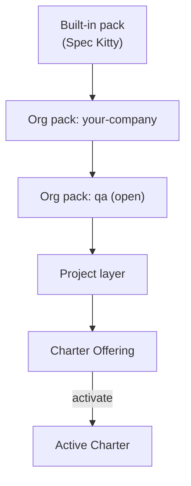

# Organisations

An organisation usually wants two things at once: **a common baseline** every project follows,
and **room for each project** to add what it needs. Charter Packs provide both through tiers.

## The three tiers

| Tier | `pack_level` | Who owns it | How a project gets it |
| --- | --- | --- | --- |
| Built-in | `built-in` | Spec Kitty | Ships with the CLI. |
| Org | `org` | Your organisation (or a community pack here) | Registered under `charter_packs.org.packs`. |
| Project | `project` | The project team | `.kittify/charter-packs/` in the repository. |

The charter merges the tiers in that order into the project's **Charter Offering**. Layers are
additive: a later layer adds artefacts and edges, and can refine an earlier one through DRG
relations (`enhances`, `overrides`, `specializes_from`). A project can register **several** org
packs — for example your company pack plus the open `qa` pack — each its own layer.



## What an org pack can enforce

An org pack turns artefacts **on for every project whose closure holds it** with a
**governing preset**: a preset whose items carry `must_have: true`:

```yaml
# presets/base.yaml in your org pack
schema_version: "1.0"
id: base
description: The required floor of every Acme project.
activated_directives:
  - id: SEC_001
    must_have: true
activated_procedures:
  - id: release-checklist
    must_have: true
activated_skills:
  - id: land-pr
    must_have: true
```

- A governing preset's must-have items are the project's required floor; the charter refuses to
  deactivate one (`409 artifact_required`, naming the requiring pack).
- To stop projects changing an artefact as well, lock it with `policy.yaml` (levels `open`,
  `extendable`, `locked`).
- `org-charter.yaml`, its `required_<kind>` lists and `skill_namespace` are retired (#242). See the
  charter's [Enforce presets on an organization's projects](https://github.com/spec-kitty/spec-kitty-charter/blob/main/docs/guides/enforce-org-presets.md) to convert one.

An org pack can also stay **inert**: ship artefacts and presets but require nothing, so each
project opts in. The open packs here (`qa`, `event-driven`, `cave-kitty`) are inert by design.

## Standard provisionings

What ships for an organisation to start from:

| Provisioning | Where | What it gives |
| --- | --- | --- |
| Built-in `default` preset | `packs/built-in/presets/default.yaml` | Every artefact of the built-in distribution (`foundation`, `writing` and the four core bundles) effective; activates the `software-dev`, `documentation`, `research` and `plan` Mission types. |
| Built-in `minimal` preset | `packs/built-in/presets/minimal.yaml` | A small curated baseline of foundational directives and tactics for `software-dev`. |
| `event-driven` preset | `packs/event-driven/presets/` | The event-sourced design paradigm, its directives, tactics and naming styleguide. |
| Opt-in packs | `packs/qa`, `packs/event-driven`, `packs/cave-kitty`, and the opt-in bundles carved from built-in (`packs/pack-authoring`, `packs/python`, `packs/java`, …) | Domain slices you activate artefact by artefact. |
| Maintainer pack | `packs/internal` | Spec Kitty's own in-house org pack — a worked example of a governing preset, `presets/base.yaml` (not shipped in the CLI). |

Apply a preset with:

```bash
spec-kitty charter activate --preset minimal
spec-kitty charter pack list        # packs in the offering and the presets each ships
```

## A typical rollout

1. **Pick a baseline** — `minimal` for a light start, `default` for everything built-in.
2. **Author your org pack** — company directives, procedures and skills, with an
   governing preset naming what is mandatory. See
   [Author a Charter Pack](../guides/author-a-charter-pack.md).
3. **Publish it** at a pinned ref ([Publish a pack](../guides/publish-a-pack.md)).
4. **Register it** in each project's `.kittify/config.yaml`, next to any open packs you adopt
   ([Use a Charter Pack](../guides/use-a-charter-pack.md)).
5. **Let projects specialise** in their own project layer.

## Planned

- **Compound packs in the CLI** — the charter service reads `depends_on` today, and the as-is CLI
  rejects it (core [#2467](https://github.com/spec-kitty/spec-kitty/issues/2467)). See
  [Compose packs](../guides/compose-packs.md).
- **Pack trust and verified distribution** (core
  [#2539](https://github.com/spec-kitty/spec-kitty/issues/2539)).
