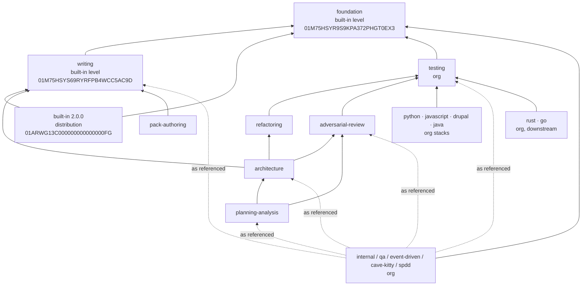

# Data Model: pack graph after the split

Arrows mean `depends_on`. Rank: foundation 0 < writing 1 < built-in 2 < org bundles 3+ (in DAG order). The full depends_on table is in membership.json. Every edge points to a lower rank, so there is no cycle. Every edge is built-in→built-in or org→built-in/org, so there is no level violation.

## Entities

**Pack** (`pack.yaml`): `pack_id` (ULID, immutable), `name`, `pack_version`, `pack_level` ∈ {built-in, org}, `parent_pack: null`, `depends_on[] {pack_id, range}`. built-in additionally has `fallback_profile`, `mutability_policy` and presets. Org packs additionally have `active_charter` and `pack_drg`.

**Node**: `urn = <kind>:<id>`. It is owned by exactly one pack (invariant: no node in two sibling packs, enforced by `pack_sibling_conflict`). Its pack comes from [membership.json](membership.json).

**Edge**: `source`, `target`, `relation`, `when`, `reason`.
- Home pack: the source's pack when the target ∈ closure(source pack). Otherwise the target's pack, with the source qualified.
- Endpoints not owned by the home pack are written `<pack-name>::<urn>`.

**Closure(p)**: p plus the transitive `depends_on` of p.
- closure(foundation) = {foundation}
- closure(writing) = {writing, foundation}
- closure(built-in) = {built-in, writing, foundation}
- closure(bundle) = the bundle plus its transitive depends_on, as listed in membership.json

## Invariants

1. Every artifact file under `packs/built-in/` before the split is under exactly one pack after it. built-in keeps only `pack.yaml`, `pack.md`, `policy.yaml`, `presets/` and `pack-manifest.yaml`.
2. No reference (graph or body) names a pack outside its writer's closure, and no reference names `built-in::`.
3. The ids `generic-agent` and every other artifact id are unchanged.
