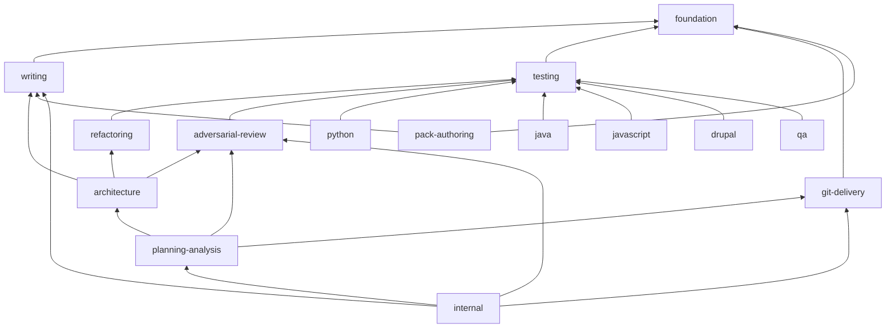

# #73 bundle squad: synthesis and foreseen opt-in bundles

Four independent lenses, all read-only, on open-packs main @ 5c489d6 and the charter at pin fb24052:

| Lens | Report | Method |
|---|---|---|
| A | `A-graph-clusters.md`, `A-clusters.json` | Louvain community detection over the DRG; 3 resolutions × 20 seeds; ≥70% co-assignment |
| B | `B-curation.md`, `B-bundles.json` | Semantic curation of all 217 staging nodes against the census, catalog #1–#16 and ADR-0048/52/53 |
| C | `C-adversarial.md` | Challenges rulings 1–6; walks the mission bodies, prompts, directives, presets and policy |
| D | `D-journeys.md` | Five consumer journeys; pack counts, registration, blast radius |

## 1. What the squad corroborates

| Ruling | Verdict | Evidence |
|---|---|---|
| No architect, diagram or planner profiles, no stacks, no DDD/C4 in foundation | **Corroborated** (A, B, C, D) | Those form clean, stable specialist clusters (A: 97–100% co-assignment). |
| The documentation mission goes to writing | **Corroborated, with a clean-up** (B, C) | Writing also needs the glossary group (B, A) and a fix for diagram-daisy → C4. |
| Opt-in specialist bundles at org level, depending on foundation | **Corroborated** | The bundle dependency DAG is acyclic after 4 moves (A) and 5 body-ref rulings (B). |
| java is its own 4-item pack (#5) | **Corroborated** (A, B) | Exactly the 4 items, as a stable cluster. |
| Org packs depend directly on the packs they use | **Corroborated, with one fix** (C, D) | The generic-agent lock and fallback must also live on foundation, or org packs that skip built-in can shadow it (C). |

## 2. What the squad counterargues

### 2.1 The strict foundation cut (115) is invalid as approved (C; A and D agree)

1. **Cycle**: analyst-annie (foundation) names DIRECTIVE_047 (writing) in her body. Ruling 1's own one-hop rule puts 047 in foundation, so the rulings contradict each other.
2. **Writing → staging body references** are illegal: writing is built-in level and cannot see an org pack.
   - lexical-larry → 2 terminology tactics.
   - diagram-daisy → USE_C4_MODEL_TECHNIQUES.
3. **Roles the base missions request are unfilled**: research asks for `researcher` (4 steps) and every retrospect step asks for `facilitator`. researcher-robbie and retrospective-facilitator would sit in staging. annie is the one seed no step asks for.
4. **Step hooks are deleted**: trunk-based and git-flow are single candidates. Removing them empties the step, and the schema needs at least one candidate. execution-lanes is the default lane workspace `spec-kitty implement` creates (B: "not an option").
5. **Hollow directives**: the 30 kept directives `require` 37 procedures and tactics. For 33 of them, a foundation directive is the only consumer, so no specialist bundle would naturally own them (B: the "core-engineering" group, 52 nodes; A: a 44-node "foundation orbit" with zero edges between its members). In C's sample, 2 of 8 pairs are hollow (010, named in 13 step contracts; 053) and 3 of 8 degrade.
6. **The `default` preset** would drop 227 of 399 nodes, since built-in cannot depend on an org pack.

### 2.2 One temporary `specialist-staging` pack has a real cost (B, D)

- 4 of the 5 in-repo org packs need it: internal 19 refs, qa 11, event-driven 6, spdd 1.
- Each carve-out is a breaking repoint of every `specialist-staging::` qualifier, about 9 times over (D).
- B accepts staging only as an undocumented holding area, carved in dependency order.

### 2.3 Stack packs cannot depend on foundation alone (B, D)

java-jenny `requires` test-first-bug-fixing and bdd-scenario-formulation; the javascript and drupal profiles are the same. So the stacks need a **testing** bundle, or testing in foundation. This directly affects PR A (java) and PR B (rust/go).

### 2.4 qa's mutation and gherkin items (B)

Six stack profiles point at the mutation directive. Keeping it in qa makes every stack depend on qa. B: move gherkin and the 4 mutation items into a `testing` bundle, and qa depends on testing.

## 3. Foreseen opt-in org bundles (consensus map)

Base: B's per-node map (`B-bundles.json`). A's clusters agree, except as noted.

| Bundle | ~Nodes | Lead profiles | depends_on | Catalog / census | Notes |
|---|---|---|---|---|---|
| `testing` | 20 (+5 from qa) | debugger-debbie | foundation | #3 | **Hub**: every stack, refactoring, adversarial-review and qa depend on it. D: widest blast radius. Candidate to fold into foundation instead. |
| `refactoring` | 35 | randy-reducer | testing | census, #10 | Includes semantic compression (A: the cleanest cluster) and 7 code-smell anti-patterns. |
| `architecture` | 35 | architect-alphonso, paula-patterns | refactoring, adversarial-review, writing | census, #2 + #7 | DDD + C4. A puts the C4 sub-cluster (12) in writing instead (D4 below). |
| `planning-analysis` | 14 | planner-priti, researcher-robbie | architecture, git-delivery, adversarial-review | #12 + #13 | Includes brownfield assessment. C wants researcher-robbie in foundation. |
| `git-delivery` | 6 | — | foundation | #9 | trunk-based, git-flow, PR workflow. Conflicts with step hooks (§2.1.4). |
| `adversarial-review` | 5 | — | testing | #11 | Squad orchestration. |
| `pack-authoring` | 7 | doctrine-daphne | foundation, writing | census, #15 | Graph-only templates. |
| `python` | 5 | python-pedro | testing | #4 | |
| `java` | 4 | java-jenny | testing | #5 | PR A. |
| `javascript` | 13 | frontend-freddy, node-norris, designer-dagmar | testing | census, #6 | Atomic design + web. |
| `drupal` | 4 | drupal-dries | testing | census | |
| *(core-engineering)* | 52 | — | foundation, writing | #1 | **The decision**: fold into foundation (A, C, D) or keep as an opt-in bundle (B: neutral). |

Returns:
- **Back to writing** (A, B): curator-carla, glossary-maintenance-workflow, kitty-glossary-writing, code-documentation-analysis, context-boundary-inference, stakeholder-alignment, terminology-extraction-mapping, glossary/stakeholder-persona/system-context-canvas templates, contextive.
- **Back to foundation** (B, C): execution-lanes, human-in-charge, retrospective-facilitator. C also adds researcher-robbie + spike-timebox-policy, adversarial-squad-deployment, test-first-bug-fixing and DIRECTIVE_047.

Cut candidates (B, C), to park for a curation pass rather than cut in #73: DIRECTIVE_039, small-explicit-code-shaping, paradigm brownfield-onboarding. Also flagged: paula-patterns tactic naming; 16 template and 13 anti-pattern graph-only nodes; ADR-0052 d15 vs AP3 for anti-pattern placement.

Bundle dependency DAG (B; acyclic):

## 4. Granularity (D)

- **Target**: 7–9 opt-in bundles plus stack leaves.
- **Cost model**: small leaves are cheap; small hubs are expensive. Going coarser re-creates the monolith.
- **Foundation shape**: with the how-to layer in foundation, bundle-to-bundle edges drop from 82 to 64, the stacks become leaves, and internal needs 5–6 packs instead of 7.

## 5. Decisions for the operator

1. **Foundation cut**:
   - (a) strict + validity fixes (~120: 047, execution-lanes, trunk-based, git-flow, example-mapping);
   - (b) (a) + the how-to layer, i.e. core-engineering folded in, + role profiles (human-in-charge, retrospective-facilitator, researcher-robbie) (~165–175; recommended by C, supported by A and D);
   - (c) (a) + a separate opt-in `core-engineering` bundle.
2. **Writing additions**: the glossary group (A, B) and/or the C4 group (A), or drop diagram-daisy's C4 reference.
3. **testing**: an opt-in hub bundle (stacks and qa depend on it), or fold into foundation. Either way, qa's mutation/gherkin items join it.
4. **Carving strategy**:
   - (a) one `specialist-staging` now, carved later in dependency order (testing first);
   - (b) carve all foreseen bundles in this PR, so names are stable from day one and there is no repoint churn;
   - (c) carve the hub bundles now (testing, plus whatever the stacks need) and stage the rest.

## 6. Operator rulings (2026-11-11) and the resulting map

- **Foundation**: the basis plus its how-to layer, the four step-contract delegates, human-in-charge, git workflow and DISCIPLINED_REFACTORING. 178 nodes.
  - retrospective-facilitator and researcher-robbie go to `planning-analysis`. Their roles fall back to Generic Giannis when that bundle is absent.
  - analyst-annie drops DIRECTIVE_047 from her body; the edge is re-declared in writing.
- **Writing**: adds the glossary group (curator-carla, terminology tactics, glossary procedure and templates, contextive). 68 entries.
  - diagram-daisy drops USE_C4_MODEL_TECHNIQUES from her body; the edge is re-declared in architecture.
- **testing**: an opt-in hub bundle. It takes qa's gherkin and mutation items; qa depends on it.
- **Carving**: every bundle is carved in this PR; there is no specialist-staging pack.
  - Bundles: testing 24, refactoring 35, architecture 35, planning-analysis 16, adversarial-review 5, pack-authoring 7, python 5, javascript 13, drupal 4, java 4.
  - git-delivery folded into foundation once trunk-based and git-flow moved there.
- **Validation**: computed with `final.py`. 0 edges have no legal home; 110 edges are re-declared in a higher pack; 2 body references are dropped (above).
