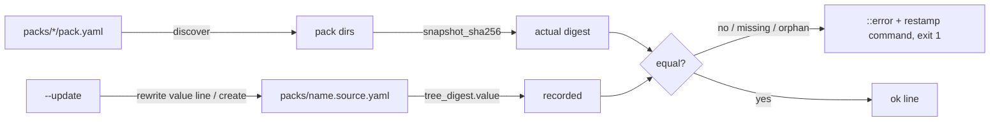

# Implementation Plan: Per-pack digest gate

**Branch**: `feat/194-pack-digests` | **Date**: 2026-11-11 | **Spec**: [spec.md](spec.md)
**Input**: Mission specification from `kitty-specs/per-pack-digest-gate-01M75YJ0/spec.md`

Branch contract: planning on `feat/194-pack-digests`, merge target `feat/194-pack-digests` (matches).

## Summary

Generalise the built-in-only digest tool into `scripts/ci/pack_digest.py` (recipe verbatim),
discover every `packs/*/pack.yaml` (19 packs), record one sidecar `packs/<name>.source.yaml` per
pack, and check them all from a renamed entry point `scripts/ci/check-pack-digests.sh` inside the
required `validate` job. Keep `built_in_digest.py` as a compatibility shim. Add the #182 residual
node-to-constituent check to `validate_pack_schemas.py`. Releases ship each pack's sidecar as
`<pack>-vX.Y.Z.source.yaml` next to its archive (IC-06). Unit tests, a new ADR, the PR template,
docs and changelog follow.

## Technical Context

**Language/Version**: Python 3.11+ (CI `python3`), Bash for the entry script
**Primary Dependencies**: PyYAML (already required); stdlib `hashlib`, `argparse`, `unittest`
**Storage**: Files — `packs/<name>.source.yaml` sidecars (YAML)
**Testing**: `unittest` under `tests/ci/` (run by the existing "Pack validator tests" step); temp-dir fixtures; `tests/ci/test_workflows.py` for the CI step
**Target Platform**: GitHub Actions ubuntu runner; local Linux/macOS
**Project Type**: single (CI scripts in a content repository)
**Performance Goals**: full check of 19 packs < 10 s (NFR-001)
**Constraints**: recipe frozen (C-001); sidecars outside the hashed tree (C-002); no ruleset change (C-003)
**Scale/Scope**: 19 packs, ~5 scripts/workflow files, 3 docs, 19 new/changed sidecars

## Charter Check

| Charter rule | Status |
|---|---|
| Gates fail closed (pack validation, built-in parity) | Pass — missing/stale/orphan sidecar fails; extends the existing parity gate to every pack |
| Generated vs authored split (DIRECTIVE_044) | Pass — digests are generated by `--update`, never hand-edited; guides explain how, and do not restate digest values |
| Generated docs pages never hand-edited | Pass — `docs/packs/` untouched; pack content does not change, so generated checksums do not move |
| Changelog entry for user-facing change | Pass — WP adds `[Unreleased]` entry |
| ADRs superseded, never edited (DIRECTIVE_003) | Pass — no existing ADR edited; a new ADR (operator answer) extends ADR 2026-10-20-1's `tree_digest` record to every pack and to release shipping; index updated |
| Tests only where they guard real behaviour (DIRECTIVE_041) | Pass — recipe vectors, fail-closed discovery, update idempotence, shim parity, node completeness |
| Bulk-edit guardrail (DIRECTIVE_035) | Pass — `occurrence_map.yaml` classifies the rename |
| Core compatibility not a blocker (AGENTS.md) | Noted — still preserved for `built-in.source.yaml` because it is cheap |

## Project Structure

### Documentation (this mission)

```
kitty-specs/per-pack-digest-gate-01M75YJ0/
├── spec.md, plan.md, research.md (+ research/A,B,C), data-model.md, quickstart.md
├── contracts/pack-digest-cli.md, contracts/sidecar.schema.yaml
├── occurrence_map.yaml
└── tasks.md, tasks/ (by /spec-kitty.tasks)
```

### Source Code (repository root)

```
scripts/ci/
├── pack_digest.py            # NEW: snapshot_sha256, discover, check, update, CLI
├── built_in_digest.py        # SHIM: imports pack_digest; same CLI (no args → print; --check)
├── check-pack-digests.sh     # RENAMED from check-built-in.sh
└── validate_pack_schemas.py  # + MANIFEST_EXEMPT_NODE_KINDS, unlisted_nodes()
packs/
├── built-in.source.yaml      # header comment refreshed; keys + value unchanged
└── <18 others>.source.yaml   # NEW, generated by --update
tests/ci/
├── test_pack_digest.py       # NEW
├── test_validate_pack_schemas.py  # + node-completeness cases
└── test_workflows.py         # + digest step in validate job
.github/workflows/validate-packs.yml  # step renamed, runs check-pack-digests.sh
docs/guides/validate-a-pack.md, docs/guides/contributing.md, docs/guides/publish-a-pack.md, docs/changelog/CHANGELOG.md, packs/README.md
docs/architecture/adr/2026-11-11-2-record-a-tree-digest-for-every-pack.md (new), docs/architecture/adr/index.md
.github/PULL_REQUEST_TEMPLATE.md      # pack-change checklist line
scripts/release/release_assets.py     # + <pack>-vX.Y.Z.source.yaml per pack, fail closed
tests/release/test_release_assets.py
.github/workflows/release.yml         # reproducibility step also compares sidecars
.kittify/charter/interview/answers.yaml  # prose mention of the script (manual_review)
```

**Structure Decision**: single project; all code under `scripts/ci/`, tests under `tests/ci/`.

## Design



CLI (`contracts/pack-digest-cli.md`): `pack_digest.py [PACK...]` prints digests;
`--check` verifies all (or named) packs and orphans; `--update` restamps; exit 0 ok, 1 violation.

## Complexity Tracking

None.

## Implementation Concern Map

### IC-01 — Generic digest tool and compatibility shim
- **Purpose**: one tested implementation of the recipe for any pack, with discover/check/update.
- **Relevant requirements**: FR-001, FR-002, FR-003, FR-004, FR-006, FR-010, NFR-001..004, C-001
- **Affected surfaces**: `scripts/ci/pack_digest.py` (new), `scripts/ci/built_in_digest.py`, `tests/ci/test_pack_digest.py` (new)
- **Sequencing/depends-on**: none
- **Risks**: recipe drift — pin built-in's known value (`ad8412…`) and a synthetic fixture vector; update must not reformat YAML.

### IC-02 — Sidecars for every pack
- **Purpose**: record fresh digests for all 19 packs via `--update`; refresh `built-in.source.yaml` comments.
- **Relevant requirements**: FR-005, FR-006, FR-008 (comments)
- **Affected surfaces**: `packs/*.source.yaml`
- **Sequencing/depends-on**: IC-01
- **Risks**: any concurrent pack change on main makes a sidecar stale at merge — rerun `--update` on rebase. Vocabulary guard scans sidecar comments.

### IC-03 — Gate wiring and rename
- **Purpose**: renamed entry script and CI step inside `validate`; workflow test.
- **Relevant requirements**: FR-007, FR-008
- **Affected surfaces**: `scripts/ci/check-built-in.sh` → `scripts/ci/check-pack-digests.sh`, `.github/workflows/validate-packs.yml`, `tests/ci/test_workflows.py`
- **Sequencing/depends-on**: IC-01, IC-02 (gate must pass when wired)
- **Risks**: step must keep `if: ${{ !cancelled() }}` and stay in `validate`.

### IC-04 — Manifest node completeness (#182 residual)
- **Purpose**: every non-exempt declared graph node of a manifest-bearing pack is a constituent.
- **Relevant requirements**: FR-009, FR-010
- **Affected surfaces**: `scripts/ci/validate_pack_schemas.py`, `tests/ci/test_validate_pack_schemas.py`
- **Sequencing/depends-on**: none (independent files)
- **Risks**: kind naming (`_singular` of fragment kinds vs `urn` prefixes) must match manifest `kind`; measured 0 findings today.

### IC-05 — Docs, changelog, prose references
- **Purpose**: guides, packs README, charter answers prose, changelog, PR template and a new ADR say what is now covered.
- **Relevant requirements**: FR-008, FR-011, FR-013, FR-014
- **Affected surfaces**: `docs/guides/validate-a-pack.md`, `docs/guides/contributing.md`, `docs/guides/publish-a-pack.md`, `docs/changelog/CHANGELOG.md`, `packs/README.md`, `.kittify/charter/interview/answers.yaml`, `.github/PULL_REQUEST_TEMPLATE.md`, `docs/architecture/adr/2026-11-11-2-record-a-tree-digest-for-every-pack.md`, `docs/architecture/adr/index.md`
- **Sequencing/depends-on**: IC-03 (final names), IC-06 (release asset name)
- **Risks**: do not edit ADRs or released changelog sections; `PROVENANCE.md` pointers to `built-in.source.yaml` stay valid (seed provenance) — leave unless wrong.

### IC-06 — Release ships each pack's sidecar
- **Purpose**: a release pinner gets the recorded tree digest next to each archive (operator answer 2).
- **Relevant requirements**: FR-012, SC-006
- **Affected surfaces**: `scripts/release/release_assets.py`, `tests/release/test_release_assets.py`, `.github/workflows/release.yml`
- **Sequencing/depends-on**: IC-02 (sidecars exist)
- **Risks**: the sidecar must come from the tagged git tree (never the working tree), like the archives; asset name `<pack>-vX.Y.Z.source.yaml` must not collide with `.tar.gz`/`.sha256`; the publish step uploads `dist/*` and counts assets, so new files are picked up without changing it; the reproducibility step should also compare the sidecars.
